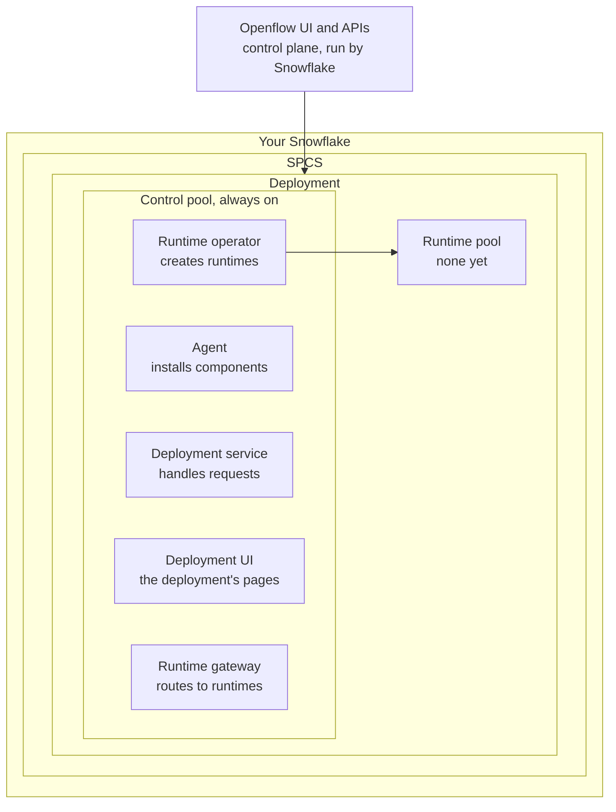

<!-- Pilot knowledge 111 item 463, version 100: DataBP demo build tutorial -->
# Openflow hands-on tutorial: SQL Server into Snowflake, with its terms

**How this tutorial is kept (Ray, 2026-11-18 09:13 ET).** This is the demo's script, not a one-time setup note: the interview shows that we can build it, so the capture is the main thing. Every step Ray takes is written here first, with its values, their sources and our choices, and only then given to Ray, quoted from here by step number. A step's result is added the moment it is known. Order of building (Ray, 2026-11-18 12:39 ET): "we first build the full baby, and then the baby grows, instead of a headless adolescent": every piece of the demo, from SQL Server to the chart in Claude, works with one table before a second table is added.

Ray installs the Openflow part himself, on top of the pieces that stay in place from the first build (knowledge 45 item 459): the SQL Server on Amazon RDS with database `MONDO_SRC` and Change Tracking on, the network rule `MONDO_LAB.NETWORK.SQLSERVER_RULE`, the external access integration `MONDO_LAB_SQLSERVER_EAI`, the execute-as role `MONDO_LAB_EXEC_RL`, the database `MONDO_LAB`, and the SQL Server JDBC driver file `mssql-jdbc-13.4.0.jre11.jar` on Serraneo. Each step says what to do and why it exists. The terms in section 3 are defined in reading order and match the DigestCards deck `openflow`.

## 1. Before you start

Claude starts the RDS instance (`aws rds start-db-instance --db-instance-identifier mondo-lab-sqlserver`) and confirms it is available. Cost while you work: the deployment's control pool and the runtime, about 0.2 credits an hour together, until section 2 step 11.

## 2. Steps

1. **Hand SYSADMIN the deployment privilege**, once, in a worksheet whose own role is ACCOUNTADMIN; Claude supplies the one grant statement. Why: so SYSADMIN creates and owns the deployment, and removing it later never needs ACCOUNTADMIN.
2. **Create the deployment** in Snowsight as SYSADMIN: Ingestion, then Openflow, then Launch Openflow, then Deployments, then Create; choose Snowflake-hosted; wait for ACTIVE. Why: the deployment hosts runtimes, and its control pool starts billing now.
3. **Create the runtime** with SQL as SYSADMIN: `CREATE OPENFLOW RUNTIME MONDO_LAB.OPENFLOW.MONDO_RUNTIME IN DEPLOYMENT "<your deployment>" NODE_TYPE = SMALL MIN_NODES = 1 MAX_NODES = 1 EXECUTE_AS_ROLE = MONDO_LAB_EXEC_RL EXTERNAL_ACCESS_INTEGRATIONS = (MONDO_LAB_SQLSERVER_EAI);` then wait with `SELECT SYSTEM$WAIT_FOR_STABLE_OPENFLOW_RUNTIMES(600, 'MONDO_LAB.OPENFLOW.MONDO_RUNTIME');`. Why: the runtime is the compute the connector runs on, and the external access integration is what lets it reach SQL Server.
4. **Open the runtime's canvas** from Openflow's Runtimes tab. On the approval page, allow only when it says role SYSADMIN with no secondary roles. Why: the runtime acts as you, so the approval decides how much it may do.
5. **Install the connector**: Connector library, filter `SQL Server`, then Install on Microsoft SQL Server CT, choosing your runtime. Why: CT is the Change Tracking connector; CDC needs an edition the lab does not have.
6. **Fill Source**: right-click the connector's box, Parameters, the Source context. Connection URL `jdbc:sqlserver://mondo-lab-sqlserver.cnlolrhi4ftv.us-east-1.rds.amazonaws.com:1433;encrypt=true;trustServerCertificate=true`; upload the driver file; username `labadmin`; password from AWS Secrets Manager (secret `rds!db-fe92cef9-…`, us-east-1). Why: where to read, and how to sign in.
7. **Fill Destination**: database `MONDO_LAB`, authentication `SNOWFLAKE_MANAGED`, role `MONDO_LAB_EXEC_RL`, warehouse `COMPUTE_WH`. Why: where to write, and as which role.
8. **Enable all controller services, then Start** the connector's box. Why: the services are shared pieces such as the database connection, and nothing flows until they are enabled.
9. **Name the table** in the Ingestion context: Included Table Names `MONDO_SRC.dbo.client`. Why: the connector replicates only the tables named here; `client` holds 20 rows.
10. **Verify**: `SELECT COUNT(*) FROM MONDO_LAB.MONDO_SRC_DBO.CLIENT;` should return 20. Then ask Claude to delete one client row in SQL Server and watch `_SNOWFLAKE_DELETED` turn true within a minute. Why: the snapshot loaded, and a hard delete arrives as a soft delete.
11. **Switch off**: Stop the connector's box; `ALTER OPENFLOW RUNTIME MONDO_LAB.OPENFLOW.MONDO_RUNTIME SUSPEND;` and Claude stops RDS. To remove everything: suspend, `TERMINATE`, and drop the runtime; then `ALTER OPENFLOW DEPLOYMENT "<your deployment>" TERMINATE;`, wait, and drop the deployment. Why: a deployment cannot be dropped while ACTIVE.

## 3. Terms, in reading order

1. **Openflow**: Snowflake's service for moving data from other systems into Snowflake, run inside Snowflake.
2. **Apache NiFi**: open-source software that moves data as a chain of small steps; Openflow is Snowflake's managed version of it.
3. **Where Openflow came from**: Snowflake bought Datavolo, founded by NiFi's creators, in November 2024, and built Openflow from it.
4. **Deployment**: the environment Openflow sets up in your Snowflake to host runtimes; one deployment can hold several runtimes.
5. **Runtime**: the compute that runs connectors inside a deployment; you create it with SQL and can suspend it.
6. **Connector**: a ready-made NiFi chain of steps that reads one source, such as SQL Server, and writes into Snowflake.
7. **Snowflake-hosted and bring-your-own-cloud**: Snowflake-hosted runs on Snowflake's own compute; bring-your-own-cloud runs inside the customer's own cloud network, keeping the data there.
8. **Control pool**: the small compute a deployment keeps running while it exists, about 0.1 credits an hour in the lab; only dropping the deployment stops it.
9. **Runtime size**: Small, Medium or Large, fixed at creation; Snowflake's SQL Server page says Medium at least, though a Small runtime loaded the lab.
10. **Suspended runtime**: costs nothing; `ALTER OPENFLOW RUNTIME` with RESUME starts it again.
11. **Gen 1 and gen 2**: two generations of Openflow; new deployments are gen 2, and gen 1 connectors, like SQL Server's, still install on gen 2 runtimes.
12. **Change Tracking**: a SQL Server feature that records which rows changed, keeping only each row's latest state, for a set retention period.
13. **CDC, change data capture**: a SQL Server feature that records every change to every row, not only the latest; not available on SQL Server Express.
14. **Change Tracking retention**: how long SQL Server keeps its record of changed rows: 2 days by default; Snowflake recommends at least 3.
15. **Snapshot**: the connector's first full copy of a table, read in primary key order.
16. **Journal table**: the Snowflake table where the connector lands each batch of changes before merging them into the destination table.
17. **Merge**: the scheduled step that applies the journal table's changes to the destination table; in the lab, every minute.
18. **Hard delete**: becomes a soft delete: the row stays, with `_SNOWFLAKE_DELETED` set to true.
19. **New column**: added in Snowflake; existing rows stay NULL until that table's replication restarts.
20. **Down longer than retention**: the missed changes are gone, and the table needs a new snapshot.
21. **Tables skipped**: tables without a primary key.
22. **TRUNCATE**: ignored: the rows stay in Snowflake.
23. **Network rule**: a Snowflake object naming an outside host and port that Snowflake may reach, such as the SQL Server on port 1433.
24. **External access integration**: the Snowflake object that hands network rules to a runtime, letting its connectors reach outside hosts.
25. **Execute-as role**: the Snowflake role the connector acts as: it creates its schemas and tables and uses the warehouse.
26. **USAGE and OPERATE on a runtime**: USAGE lets a role install and change connectors; OPERATE lets it suspend and resume the runtime.
27. **The sign-in loop**: Openflow's sign-in refuses admin roles such as ACCOUNTADMIN; a default role of SYSADMIN with no secondary roles fixed it.
28. **Canvas**: the NiFi screen where a gen 1 connector appears as one box, started and stopped from there.
29. **Parameter contexts**: the connector's settings, grouped in three: Source, Destination and Ingestion.
30. **Controller services**: shared pieces the connector's steps use, such as the database connection; enabled before the connector starts.
31. **Set-up order**: Source, then Destination, then enable the controller services and start the connector, then name the tables in Ingestion.
32. **Openflow or Fivetran**: Openflow has no license fee but is an engine you operate; Fivetran sets up in minutes and bills per row changed each month.

## 4. What a deployment is, physically

Worked out live with Ray on 2026-11-12. A Snowflake-hosted deployment is running machines, not configuration: a compute pool on Snowpark Container Services (SPCS), Snowflake's container service inside your own Snowflake, not in any database or warehouse. SPCS runs container images on compute pools and decides where each one runs, much as Kubernetes does. Openflow's images belong to Snowflake: hosted on SPCS, Snowflake runs them for you; in bring-your-own-cloud they run on EKS, Amazon's Kubernetes, in your own AWS environment.

| # | Component | What it does | Basis |
| --- | --- | --- | --- |
| 1 | Runtime operator | Creates and looks after runtimes | Assumed from Kubernetes naming; BYOC docs name an operator |
| 2 | Agent | Installs components; pulls Snowflake's images | Documented for BYOC |
| 3 | Deployment service | Handles runtime requests | Inferred from Snowflake's docs |
| 4 | Deployment UI | The deployment's pages | Inferred from the name |
| 5 | Runtime gateway | Routes to runtimes | Inferred from the name |

The five components run on the deployment's control pool, which keeps running, and billing, with no runtimes at all. Runtimes run on a separate compute pool of their own. Snowflake's docs list the five components without ranking them; the runtime operator as the center of the deployment is a working assumption.



Sources: Snowflake, About Openflow; About Openflow - Snowflake Deployments; Openflow Snowflake Deployment cost and scaling considerations; Manage Openflow; Set up Openflow - BYOC.

## 5. The BYOC build: from the AWS network to the canvas (2026-11-17 and 18)

Sections 1 to 4 are the Snowflake-hosted build of 2026-11-11, with MONDO names. This section is the build now running, Openflow BYOC (bring your own cloud): Snowflake keeps the Openflow screens, and the machines that move the data run in our AWS account, us-east-1, next to the source. Terms are in the Openflow BYOC lexicon (knowledge 110 item 797); values are in the lab design's section 0 (knowledge 45 item 459), read from AWS and Snowflake. Part A is the cloud admin's work, Part B the data engineer's (Snowflake's BYOC page divides the work this way).

### Part A: the cloud admin (Claude, 2026-11-17)

1. **The network.** In VPC `digest-vpc` (10.20.0.0/16), two private subnets: `databp-byoc-private-a` (10.20.64.0/18, us-east-1a) and `databp-byoc-private-b` (10.20.128.0/18, us-east-1b); a NAT gateway in the public subnet `digest-public-1`, with an elastic IP; the private subnets' route table sends 0.0.0.0/0 to the NAT gateway; security group `databp-openflow-private`. Why: the data plane lives in our network with no inbound path from the internet, and reaches out (to Snowflake, to Snowflake's image registry) only through the NAT gateway.
2. **Open the SQL Server to that network.** On the RDS instance's security group, allow port 1433 from both private subnets. Why: the connector will read SQL Server from inside the VPC, so no Snowflake address needs to reach it.
3. **Create the deployment** in Openflow's screens: Deployments, Create, BYOC, with the VPC type "bring your own VPC" (VPC type PROVIDED). Name `DATABP_OPENFLOW`, owner SYSADMIN. Openflow then generates a CloudFormation template for this deployment. Why: the deployment is the container for runtimes; choosing "Managed" instead makes Openflow build its own VPC, which is not the BYOC setup we wanted (two such deployments were created by mistake and terminated: `MONDO_BYOC`, `DATABP_BYOC`).
4. **Launch the stack.** In CloudFormation (us-east-1), create stack `databp-openflow` from the generated template, choosing `digest-vpc` and the two private subnets. Read 2026-11-18, the stack created: the agent machine `openflow-agent-id8ft6g6` (EC2 t3.medium), its IAM role and instance profile, a secret, an S3 bucket, and an EC2 Instance Connect endpoint. CREATE_COMPLETE 2026-11-17 19:51 UTC. Why: the stack is the one-click way to create the agent with the permissions it needs.
5. **Wait for the agent to build the cluster.** The agent creates EKS cluster `id8ft6g6` (Kubernetes 1.36, API endpoint private), node groups `mgmt` (1 node, m7i.2xlarge) and `sm`, `md`, `lg` (0 nodes each, up to 50), and the load balancer `runtime-ingress-id8ft6g6`. The deployment turns ACTIVE: created 14:47 ET, ACTIVE 15:46 ET, about an hour. Why: the cluster is where runtimes run. That the agent builds it is concluded from watching the build (the stack does not declare it), not stated in Snowflake's documentation.
6. **Create the runtime** from Openflow's form (Ray, 2026-11-17, about 18:05 ET): `DATABP_RUNTIME` in `DATABP_LAB.OPENFLOW`, node type Small, 1 to 1 nodes, execute-as role `DATABP_LAB_EXEC_RL`, no external access integration. Within a minute the `sm` node group went from 0 to 1 node, an m7i.xlarge machine. Why: the runtime is the compute the connector runs on; on BYOC it reaches the source through the VPC, so it needs no network rule or external access integration. The grants of `DATABP_LAB_EXEC_RL` were not read tonight.

### Part B: the data engineer (Ray, 2026-11-18)

7. **Open the canvas.** Openflow's Runtimes, `DATABP_RUNTIME`. Approve the sign-in only when it shows role SYSADMIN with no secondary roles. The canvas opens empty.
8. **Install the connector.** From Openflow's Connector library, not the canvas toolbar: filter "SQL Server", choose Microsoft SQL Server CT (the Change Tracking connector; the CDC one needs an edition other than Express), install onto `DATABP_RUNTIME`. On the canvas it appears as one box, `SQLServer`: 60 processors stopped, 42 invalid until its parameters are filled. Double-clicking the box shows its four groups (Snapshot Load, Incremental Load, Metrics, Stream Staleness Prevention); clicking "Openflow" in the trail at the bottom left returns to the box.
9. **Fill the Source parameters.** Right-click `SQLServer`, Parameters, the group named for Source parameters:
   - SQLServer Connection URL, typed whole: `jdbc:sqlserver://databp-lab-sqlserver.cnlolrhi4ftv.us-east-1.rds.amazonaws.com:1433;encrypt=true;trustServerCertificate=true`. AWS supplies only the endpoint and the port (RDS, Databases, `databp-lab-sqlserver`, Connectivity & security); `jdbc:sqlserver://` and the two settings are the engineer's (lexicon term 24).
   - SQLServer JDBC Driver: upload `mssql-jdbc-13.4.0.jre11.jar`, on Serraneo at `C:\Users\rayse\job-hunt-sets\mondo-lab\`.
   - SQLServer Username and Password: from AWS Secrets Manager, the RDS-managed secret `rds!db-fe92cef9-…` (us-east-1); the engineer pastes them, never an agent.
   - SQLServer Query Interval: `10 sec`: how often the connector asks SQL Server which rows changed.
10. **Fill the Destination parameters.** Destination Database `DATABP_LAB`; Snowflake Role `DATABP_LAB_EXEC_RL`; Warehouse `COMPUTE_WH`; Destination Schema Pattern `${source.database.name}_${source.schema.name}` (schema DATABP_SRC_DBO); Error Handling and Oversized Value Strategy `Fail Table`; Object Identifier Resolution `CASE_INSENSITIVE`; Table Storage Format `STANDARD`. Snowflake Authentication Strategy, a free-text field: type `SNOWFLAKE_MANAGED`, Snowflake's default for both Snowflake-hosted and BYOC deployments; the runtime obtains its Snowflake token itself and acts as its execute-as role, which BYOC needs configured beforehand (here `DATABP_LAB_EXEC_RL`). With it, Snowflake Account Identifier and the private key fields stay blank. The alternative on BYOC only, KEY_PAIR, needs a service user with a key (Snowflake, About Openflow; Set up the Openflow Connector for Microsoft Dataverse; read 2026-11-18).
11. **Start, then name the table, then verify.** Right-click `SQLServer`, Enable all controller services, then Start; then Parameters, the Ingestion parameters, Included Table Names `DATABP_SRC.dbo.client`, Apply. Result, 2026-11-18: schema `DATABP_LAB.DATABP_SRC_DBO` created 07:16:59 UTC with `CLIENT` and its journal table; `CLIENT` held 0 rows at 07:17 and 20 at 07:18, matching SQL Server's 20 (the minute between is the merge from journal to table).
12. **Verify a change.** In SQL Server, `update dbo.client set client_name = 'Client 1 (changed 2026-11-18)' where client_id = 1` at 07:21:46 UTC. In Snowflake, client 1 showed the new name with `_SNOWFLAKE_UPDATED_AT` 07:23:01 UTC, about 75 seconds later; the row count stayed 20, since an update changes a row in place. Why: this is the incremental half, Change Tracking polled every 10 seconds, then merged.

13. **Watch a change in DBeaver, source and target side by side** (the interview's visual demo, Ray, 2026-11-18). Two connections:

| # | Setting | SQL Server (source) | Snowflake (target) |
|---|---|---|---|
| 1 | Host or account | `databp-lab-sqlserver.cnlolrhi4ftv.us-east-1.rds.amazonaws.com`, port 1433 | Account `FIAMFDN-IGB87170` |
| 2 | Database | `DATABP_SRC`, table `dbo.client` | `DATABP_LAB`, schema `DATABP_SRC_DBO`, table `CLIENT` |
| 3 | Login | `labadmin`, password from Secrets Manager `rds!db-fe92cef9-…` | User `RAYSERRANO`, role `DEV_RAYSERRANO_ROLE`, which holds `DATABP_LAB_READ_RL` (granted below), warehouse COMPUTE_WH |
| 4 | Encryption | On, trusting the server certificate | Default |
| 5 | Network | The SQL Server's security group admits port 1433 from Serraneo's public address (69.85.117.192/32, entry sgr-023206ef813a5277f, added 2026-11-18, removed at cleanup) | Reachable from anywhere |

The Snowflake user's read access, run by Ray in Snowsight as RAYSERRANO_ADMIN, role SECURITYADMIN, 2026-11-18 08:54 ET:

```sql
CREATE ROLE IF NOT EXISTS DATABP_LAB_READ_RL COMMENT = 'Read the Openflow landing tables in DATABP_LAB (DataBP demo)';
GRANT USAGE ON DATABASE DATABP_LAB TO ROLE DATABP_LAB_READ_RL;
GRANT USAGE ON SCHEMA DATABP_LAB.DATABP_SRC_DBO TO ROLE DATABP_LAB_READ_RL;
GRANT SELECT ON ALL TABLES IN SCHEMA DATABP_LAB.DATABP_SRC_DBO TO ROLE DATABP_LAB_READ_RL;
GRANT SELECT ON FUTURE TABLES IN SCHEMA DATABP_LAB.DATABP_SRC_DBO TO ROLE DATABP_LAB_READ_RL;
GRANT ROLE DATABP_LAB_READ_RL TO ROLE SYSADMIN;
GRANT ROLE DATABP_LAB_READ_RL TO ROLE DEV_RAYSERRANO_ROLE;
```

Why: the landing tables belong to the execute-as role, so a person's role needs read access granted; the future-tables grant covers tables the connector creates later. Result: RAYSERRANO sees `CLIENT` and its journal table in DBeaver.

Then change a value in `dbo.client` in DBeaver's SQL Server connection and refresh `CLIENT` in the Snowflake connection: the change appears within about a minute and a half (step 12). If Serraneo's public address changes, the security group entry must change with it. The password rotates weekly (next 2026-11-25), and DBeaver's saved copy then needs the new one too.

The demo run of 2026-11-18: Ray changed client 2 to `Client 2 (demo)` in DBeaver at about 08:55 ET; SQL Server's change tracking version went from 28 to 29; the journal table gained a row; `CLIENT` showed the new name with `_SNOWFLAKE_UPDATED_AT` 13:59:00 UTC, 3 to 4 minutes later (75 seconds at 07:21; why slower not known). For the interview, allow up to 4 minutes, or show the journal row first: it lands before the merge. The journal keeps its rows after the merge (2 rows after two changes). Its columns: PRIMARY_KEY__CLIENT_ID, PAYLOAD__CLIENT_ID, PAYLOAD__CLIENT_NAME, LEAST_SIGNIFICANT_POSITION, MOST_SIGNIFICANT_POSITION, EVENT_TYPE (IncrementalUpdateRows), SEEN_AT, SF_METADATA (offset_token, the change tracking version).

14. **dbt platform, the Snowflake side** (Ray's 1y, 2026-11-18 09:00 ET). dbt platform connects to Snowflake by key pair: new credentials there cannot use a password (docs.getdbt.com, Connect Snowflake, read 2026-11-18).
   - The key pair, generated by Claude on Serraneo with Git's openssl (`C:\Program Files\Git\usr\bin\openssl.exe`): `genrsa 2048`, then `pkcs8 -topk8 -nocrypt` into `C:\Users\rayse\job-hunt-sets\mondo-lab\databp_dbt_key.p8` (the private key, unencrypted, never printed), then `rsa -pubout` into `databp_dbt_key.pub` (the public key). Our choice: unencrypted, so dbt's passphrase field stays blank; dbt permits it.
   - The statements, put on Serraneo's clipboard with the public key's body (the .pub file without its BEGIN and END lines) in place of `<PUBKEY>`; Ray runs them in Snowsight as RAYSERRANO_ADMIN:

```sql
USE ROLE SECURITYADMIN;
CREATE ROLE IF NOT EXISTS DATABP_DBT_RL COMMENT = 'dbt platform builds over the Openflow landing tables (DataBP demo)';
CREATE USER IF NOT EXISTS DATABP_DBT_SVC TYPE = SERVICE DEFAULT_ROLE = DATABP_DBT_RL DEFAULT_WAREHOUSE = COMPUTE_WH COMMENT = 'dbt platform service user (DataBP demo)';
ALTER USER DATABP_DBT_SVC SET RSA_PUBLIC_KEY = '<PUBKEY>';
GRANT ROLE DATABP_DBT_RL TO USER DATABP_DBT_SVC;
GRANT ROLE DATABP_DBT_RL TO ROLE SYSADMIN;
GRANT ROLE DATABP_LAB_READ_RL TO ROLE DATABP_DBT_RL;
GRANT USAGE ON DATABASE DATABP_LAB TO ROLE DATABP_DBT_RL;
GRANT CREATE SCHEMA ON DATABASE DATABP_LAB TO ROLE DATABP_DBT_RL;
GRANT USAGE ON WAREHOUSE COMPUTE_WH TO ROLE DATABP_DBT_RL;
SHOW GRANTS TO ROLE DATABP_DBT_RL;
```

   Why each: a service user (TYPE = SERVICE) cannot sign in with a password or interactively, only by key; DATABP_LAB_READ_RL lets dbt read the landing tables; CREATE SCHEMA lets dbt create its own schemas for the layers; the role is granted to SYSADMIN so SYSADMIN can see and drop what dbt builds. Expected result: SHOW GRANTS lists 4 rows. Result, Ray, 2026-11-18 09:07 ET: 4 rows, CREATE SCHEMA and three USAGE (the database, the warehouse, and the role DATABP_LAB_READ_RL, which SHOW GRANTS lists as USAGE on a role).
15. **dbt platform, the account** (Ray, after step 14). Which account (Ray, 09:42 ET, answer 1b): a new dbt account under a new integrationals.com address, not an upgrade of Ray's free Developer account (ray.serrano@integrationals.com). The address is an alias on Ray's existing WorkMail user, so its mail lands in his inbox: aliases cost nothing extra, up to 100 per user (AWS re:Post); added in the WorkMail console, Organizations, the organization, Users, Ray's user, Aliases, Add alias. Done by Claude at 09:45 ET from Serraneo's AWS CLI (Ray's 1y): `aws workmail create-alias --region us-east-1 --organization-id m-be841c4ca30347dc84285454f2da9c8f --entity-id fc55583e-c222-4e2f-afba-f74f77a03190 --alias dbt-demo@integrationals.com` (organization integrationals-com, Active; the user ray.serrano, who now has the aliases data.architect@, dbt-demo@ and ray.serrano@integrationals.com). Run from Serraneo because the session misread the vault item "claude-ws AWS Key" as empty; its key is a JSON file attached to it, which Provisioning — Agentic common (COMMON-08) reads on the workstation. Cleanup: `aws workmail delete-alias` with the same values. Sign up at getdbt.com with `dbt-demo@integrationals.com`, account name "Demo Account" (Ray, 09:48 ET: open about what it is, a demo of dbt for a prospective client); the trial is two weeks of the Starter plan, offered only at signup; Starter includes the Semantic Layer (docs.getdbt.com, Billing FAQs, read 2026-11-18). Ray sets the password and enters the verification code himself. Connection values, choosing Snowflake as the warehouse:

| # | Field | Value | Source |
|---|---|---|---|
| 1 | Account | `fiamfdn-igb87170` | Snowflake's account identifier, organization-account |
| 2 | Database / Warehouse | `DATABP_LAB` / `COMPUTE_WH` | The grants of step 14 |
| 3 | Role / Username | `DATABP_DBT_RL` / `DATABP_DBT_SVC` | Created in step 14 |
| 4 | Auth method | Key pair | dbt platform: new Snowflake credentials cannot use a password |
| 5 | Private key / passphrase | The whole content of `C:\Users\rayse\job-hunt-sets\mondo-lab\databp_dbt_key.p8`, BEGIN and END lines included / blank | Generated in step 14, unencrypted (our choice); Ray copies it himself |

Getting the private key into dbt (Ray, 09:22 ET): when Ray asks, Claude puts the key file's content onto Serraneo's clipboard with PowerShell (`Get-Content -Raw <file> | Set-Clipboard`), without reading or printing it; Ray pastes it into dbt's Private Key field. Copying anything afterwards replaces it on the clipboard.
   Project setup, after signup (Ray, 09:55 ET): project name `DataBP Demo` (Claude's suggestion, our choice: a label in dbt platform only; the code's own project name in `dbt_project.yml` is `databp`, and the repository is `Integrationals/databp-dbt`). Then the connection (the table above), then the repository (step 16). The connection page's note: dbt always connects from 52.3.77.232, 3.214.191.130 or 34.233.79.135. Nothing to open here: the account has no network policy (NETWORK_POLICY empty, read 2026-11-18) and DATABP_DBT_SVC has none; a production account with a network policy would add these three addresses to it.

16. **The dbt repository** (Ray's 2b, 09:22 ET: a new private repository under Integrationals, not dbt's managed repository). Our choices: name `Integrationals/databp-dbt`, private, default branch `main`, created by Claude through GitHub's API. dbt platform then connects to it in its project setup (Settings, the project, Repository): through dbt's GitHub app, which Ray authorizes on the Integrationals organization, or with Git Clone, pasting `git@github.com:Integrationals/databp-dbt.git`, where dbt shows a deploy key that is added to the repository with write access. Ray's choice (10:10 ET): dbt's GitHub app, because the repository may be reused for future demos. How, from dbt's documentation (Connect to GitHub, read 2026-11-18): installing the app needs a GitHub organization owner, here rayserrano2735, so the browser must be signed in to GitHub as that user. In the project setup's repository step, choose GitHub; if dbt says no account is linked, go to the profile's Linked accounts, select Link, and authorize dbt on GitHub's grant screen. Then install dbt's app in the Integrationals organization with "Only select repositories": `databp-dbt`. Back in dbt, pick `Integrationals/databp-dbt` from the list. Found 10:12 ET: dbt's list under Integrationals showed only `digest-datavault`, which is private (read with the admin credential), so the list is not limited to public repositories; the likely cause is that dbt's app was installed earlier with only digest-datavault selected (not confirmed: the admin token may not list the organization's app installations, HTTP 403). Fix: github.com/organizations/Integrationals/settings/installations, dbt's app, Configure, Repository access, add `databp-dbt`, Save. The layers, Harbor's pattern cut to what one hour of demo shows (Claude's proposal, from the interview preparation, item 460, Q1 row 3 and Q2 row 1): a source over `DATABP_LAB.DATABP_SRC_DBO`; staging `stg_databp__client` with a business key in the source's namespace, a hash key and a change hash; a mart `dim_client`; a semantic model and a metric `client_count`, queried through the dbt MCP server. How it was created, 09:30 ET: on Serraneo, with the vault's Integrationals admin credential (`op://Agentic Workstation/github integrationals admin/credential`, read by Serraneo's 1Password CLI into the environment variable GH_TOKEN for the one command, then removed), which signs in as rayserrano2735, the organization's admin: `gh repo create Integrationals/databp-dbt --private`. Two routes that fail, not to retry: the workstation's GitHub proxy refuses organization endpoints whatever the token; and Serraneo's former gh account rayserrano-del is not an organization admin (removed from Serraneo at 09:31 ET, Ray's instruction: gh logged out, its Windows credential `git:https://github.com` deleted). The push, 09:33 ET: the project written into Serraneo's clone `C:\Users\rayse\Dropbox\Projects\GitHub\Integrationals\databp-dbt` (its tree hash 55c6b0a matched the workstation's), committed as 6f37875, and pushed to `main` with the same credential passed to git through environment variables (GIT_CONFIG_COUNT with an http extraheader), never in a command argument. The workstation's machine user can read the repository but not push.

17. **The dbt project's files** (Claude, 09:24 to 09:26 ET, on the workstation in `~/databp-dbt`; in the repository as commit 6f37875 on main, step 16). Columns read from Snowflake first: CLIENT holds CLIENT_ID (number), CLIENT_NAME (text), _SNOWFLAKE_INSERTED_AT and _SNOWFLAKE_UPDATED_AT (timestamp_ntz), _SNOWFLAKE_DELETED (boolean).

| # | File | What it holds | Why |
|---|---|---|---|
| 1 | `dbt_project.yml` | Project `databp`, profile `databp`; staging as views in schema staging, marts and utilities as tables | dbt platform prefixes the schema names with the environment's own |
| 2 | `models/staging/_sources.yml` | Source `databp_src` = `DATABP_LAB.DATABP_SRC_DBO`, table `client`; freshness on `_SNOWFLAKE_UPDATED_AT`, warn 2 h, error 4 h; tests not_null and unique on client_id | The interview's freshness answer (item 460, Q3 row 4), built. In dbt v2, `loaded_at_field` and `freshness` go under `config:` (parse error dbt1060 otherwise) |
| 3 | `macros/business_key.sql` | `business_key(source, table, id)` returns `'SOURCE|TABLE|' || id` | Harbor's namespace pattern (item 460, Q2 row 1) |
| 4 | `models/staging/stg_databp__client.sql` and `.yml` | client_bk `DATABP|CLIENT|<id>`, client_hk md5 of it, change_hash md5 of client_name, is_deleted, landed_at, changed_at; tests on both keys | Typed and keyed in the source's namespace |
| 5 | `models/marts/dim_client.sql` and `.yml` | Current clients (deleted filtered out), with landed_date; semantic model on it: entity `client` (client_hk, primary), dimensions client_name and landed_date (day); metric `client_count`, count distinct of client_hk | The latest Semantic Layer spec: semantic_model, columns with entity and dimension, metrics on the model (docs.getdbt.com, Semantic models, read 2026-11-18) |
| 6 | `models/utilities/metricflow_time_spine.sql` and `.yml` | One row per day from 2020-01-01, 4,018 rows; `time_spine: standard_granularity_column: date_day` | MetricFlow needs a time spine for time dimensions |

Checked: `dbt parse` (dbt 2.0.12, a parse-only profile, no connection) finishes with one warning, that semantic validation is skipped without a dbt platform config; `dbt sl validate` runs once the project is in dbt platform. The parse-only profile is `~/.dbt/profiles.yml` on the workstation, a config file, not in the repository.

**Claude's access to the dbt account** (Ray, 10:16 ET: "we need to give you access to this dbt"). The workstation reaches dbt platform's API (read 10:18 ET: cloud.getdbt.com answers "Authentication credentials were not provided", so dbt answered, not the proxy). Access is a personal access token of Ray's dbt user: in dbt, the account name at bottom left, Account settings, API tokens, Personal tokens, Create; Ray copies it straight into a new 1Password item in the vault "Agentic Workstation", named `dbt Demo Account PAT` (type API Credential, the token in its credential field, the account's access URL in hostname, and the account ID, the number after /accounts/ in dbt's address bar, in username). Claude reads it from the vault into the environment for each call, never printing it. The vault's older item "Claude dbt PAT" is for Ray's other dbt account. As saved (10:23 ET): item `dbt DataBP Demo Account PAT`; the token in credential (55 characters); the account ID and host in two added fields that 1Password names by id, because the item already had empty username and hostname fields: account ID 70506183177172 (field wmr4vozidckbbauzomxhffr25m) and host `eg472.us1.dbt.com` (field osrxw537l4r7cok2dwto5rghxe). Read as `op://Agentic Workstation/dbt DataBP Demo Account PAT/<field id>`. Tested 10:24 ET with the Administrative API: account "Integrationals", plan trial_2025, 1 developer seat, 5 run slots; project `DataBP Demo` (70506183180861) on `Integrationals/databp-dbt`, connection 70506183164252; environment `Development` (70506183170894), dbt version v2-stable.

**Studio's development credentials** (Ray, 12:01 ET). Studio showed: "dbt Cloud wasn't able to set up your development connection. Please double check that you've properly configured your project connection and development credentials." Read 12:01 ET through the API: the project holds one credential, Production's; Ray's development credentials are not set. Fix, from dbt's documentation (Set up the dbt Semantic Layer, read 2026-11-18: Account settings, Credentials, select the project, Edit, User credentials): auth method Key pair, username `DATABP_DBT_SVC`, the step 14 key, role `DATABP_DBT_RL`, warehouse `COMPUTE_WH`, database `DATABP_LAB` (the connection's, read 10:38 ET), schema `dbt_rserrano` (our choice: development builds land apart from Production's `databp` and Claude's `dbt_claude`). Result: Ray ran `dbt build` in Studio at 12:06 ET, all green; read in Snowflake: DBT_RSERRANO_MARTS.DIM_CLIENT 20 rows, DBT_RSERRANO_STAGING.STG_DATABP__CLIENT (view), DBT_RSERRANO_UTILITIES.METRICFLOW_TIME_SPINE 4,018 rows, created 17:06 UTC. Cleanup adds the DBT_RSERRANO_* schemas.

18. **Build in the development environment** (Ray, 10:16 ET: repository and connection added, so the project has its development environment). Open Studio, dbt's browser IDE, from the main menu; it clones `main` and parses the project. In its command line at the bottom, run `dbt build`: it creates the staging view, the mart and the time spine in schemas named from the development credentials' schema (dbt's default is `dbt_` plus the user's name) with `_staging`, `_marts` and `_utilities` added, and runs the tests (not_null and unique on the keys). Then `dbt sl validate`, which checks the semantic model and the metric. Expected: every model and test passes; client_count validates.

How it was done instead (10:26 to 10:30 ET): from the workstation's dbt CLI (dbt 2.0.12), not Studio. Ray granted the role to the workstation's Snowflake user in Snowsight as RAYSERRANO_ADMIN: `USE ROLE SECURITYADMIN; GRANT ROLE DATABP_DBT_RL TO USER CLAUDE_WS;` (put on his clipboard). The CLI's profile, `~/.dbt/profiles.yml` on the workstation (a config file, mode 600): profile `databp`, target `claude`, type snowflake, account `fiamfdn-igb87170`, user `CLAUDE_WS`, `private_key_path` the workstation's Snowflake key, role `DATABP_DBT_RL`, database `DATABP_LAB`, warehouse `COMPUTE_WH`, schema `dbt_claude`, threads 4. `dbt debug`: all checks passed. `dbt build`, 10:29 ET: 11 of 11 succeeded in 8.9 seconds: the time spine table, the staging view `DBT_CLAUDE_STAGING.STG_DATABP__CLIENT`, the mart table `DBT_CLAUDE_MARTS.DIM_CLIENT`, and 8 tests (not_null and unique on the source's client_id, the staging keys and the mart's key). DIM_CLIENT holds 20 rows, 2 of them the changed clients 1 and 2. The one warning: semantic validation is skipped without a dbt_cloud.yml, the CLI's link to dbt platform. Cleanup adds: revoke DATABP_DBT_RL from CLAUDE_WS; drop the DBT_CLAUDE_* schemas.

What dbt requires before the Semantic Layer (docs.getdbt.com, Administer the Semantic Layer and Deployment environments, read 2026-11-18): a deployment environment with deployment credentials (a connection profile), a successful run in it, and then the Semantic Layer's configuration in the project's details: select that environment, add a Semantic Layer credential (the warehouse login its queries run as), and create a service token mapped to it. Ray noted at 10:32 ET that the project still shows no "analytics credential" and no Semantic Layer configuration. The project page's own text (Ray, 10:36 ET): "Analytics credential: Choose the connection this project uses for ad-hoc querying in dbt Wizard and Semantic Layer integrations. Only connections with analytics credentials configured are listed." Read through the API at 10:38 ET: the connection "Snowflake DataBP" (70506183164252) already carries analytics credentials (analytics_credentials_id 70506183175894), while the project's analytics_connection_id is empty: the project has not chosen the connection yet. Ray assigned it in the project page at 10:38 ET; read back 10:39 ET: analytics_connection_id 70506183164252 ("Snowflake DataBP"). The Semantic Layer configuration is still empty.

The Semantic Layer configuration (Ray, 10:55 ET, in the project's settings): the page has two parts, the Semantic Layer itself and a Semantic Layer service token, which comes first. What the token is, from dbt's documentation (Administer the Semantic Layer, read 2026-11-18): the Semantic Layer authenticates callers by service tokens, each tied to a data platform credential configured on the same page; the credential is the Snowflake login the Semantic Layer's queries run as. The token's value is shown once: Ray copies it straight into a new vault item, so the dbt MCP server can read it later. Names (Ray, 11:06 ET: DataBP in both): in dbt, `DataBP Semantic Layer`; in the vault "Agentic Workstation", item `dbt DataBP Semantic Layer Token`, the token in its credential field. Permissions (Ray, 11:07 ET: Semantic Layer and Metadata offered): add Developer, since dbt's remote MCP documentation (Set up remote MCP, read 2026-11-18) says a token needs Semantic Layer and Developer permissions to use remote MCP fully; Metadata serves the Discovery tools (models, lineage). Not covered by any service token: the MCP tool execute_sql, which takes a personal access token only. As created (Ray, 11:09 ET): Semantic Layer and Metadata only; Developer is not offered for this token, and this token is for querying. Other dbt work goes through the dbt CLI (`dbt sl` commands) and the Administrative API with the personal access token. Saved 11:10 ET in the vault as item `DataBP Semantic Layer` (type API Credential), the token in credential, 55 characters; read as `op://Agentic Workstation/DataBP Semantic Layer/credential`.

**The Snowflake side of the Semantic Layer credential** (Ray, 11:00 ET: Snowflake first; Claude does it and captures it). dbt recommends read-only credentials for the Semantic Layer (Administer the Semantic Layer, read 2026-11-18), and its Snowflake Semantic Layer credential takes key pair authentication (the dbtcloud Terraform provider's SnowflakeSemanticLayerCredential, read 2026-11-18). Our choices: a service user of its own, DATABP_SL_SVC, with a read-only role DATABP_SL_RL, separate from dbt's builder DATABP_DBT_SVC, so the Semantic Layer can read but never write. Key pair generated on Serraneo with Git's openssl as in step 14: `C:\Users\rayse\job-hunt-sets\mondo-lab\databp_sl_key.p8` (private, unencrypted, never printed) and `databp_sl_key.pub`. The statements, run as SECURITYADMIN, with the public key's body in place of `<PUBKEY>`:

```sql
USE ROLE SECURITYADMIN;
CREATE ROLE IF NOT EXISTS DATABP_SL_RL COMMENT = 'dbt Semantic Layer reads the dbt-built schemas in DATABP_LAB, read only (DataBP demo)';
CREATE USER IF NOT EXISTS DATABP_SL_SVC TYPE = SERVICE DEFAULT_ROLE = DATABP_SL_RL DEFAULT_WAREHOUSE = COMPUTE_WH COMMENT = 'dbt Semantic Layer service user (DataBP demo)';
ALTER USER DATABP_SL_SVC SET RSA_PUBLIC_KEY = '<PUBKEY>';
GRANT ROLE DATABP_SL_RL TO USER DATABP_SL_SVC;
GRANT ROLE DATABP_SL_RL TO ROLE SYSADMIN;
GRANT USAGE ON WAREHOUSE COMPUTE_WH TO ROLE DATABP_SL_RL;
GRANT USAGE ON DATABASE DATABP_LAB TO ROLE DATABP_SL_RL;
GRANT USAGE ON FUTURE SCHEMAS IN DATABASE DATABP_LAB TO ROLE DATABP_SL_RL;
GRANT SELECT ON FUTURE TABLES IN DATABASE DATABP_LAB TO ROLE DATABP_SL_RL;
GRANT SELECT ON FUTURE VIEWS IN DATABASE DATABP_LAB TO ROLE DATABP_SL_RL;
SHOW GRANTS TO ROLE DATABP_SL_RL;
```

Why the future grants are at the database level: the production schemas do not exist yet; dbt creates them at its first production run, and the role must read them from then on. Snowflake applies a schema's own future grants in place of the database's, so in DATABP_SRC_DBO, which has its own (step 13), these do not apply; the Semantic Layer reads the marts, not the source. Who runs it: Claude, through Serraneo's snow connection ray_admin (user RAYSERRANO_ADMIN), if that connection works; it failed at 08:44 ET with 250001. Its settings, read 11:02 ET from `C:\Users\rayse\.snowflake\config.toml` with the password hidden: account fiamfdn-igb87170, user RAYSERRANO_ADMIN, role ACCOUNTADMIN, warehouse compute_wh, authenticator `username_password_mfa`, so each sign-in waits on an MFA approval. Done 11:03 ET: the key pair generated (openssl pkey check passed), and the statements composed with the public key filled in, held in Serraneo's PowerShell session (not on the clipboard, not in a file). Run 11:04 ET by Claude (Ray's 1y, Ray approving the MFA prompt): piped into `snow sql -i -c ray_admin --role SECURITYADMIN --enable-templating NONE --format JSON`, 16 seconds; this morning's 250001 did not recur. All 12 succeeded: role DATABP_SL_RL created, user DATABP_SL_SVC created, the key set, the grants made. Snowflake's warning on the future tables grant, as expected: "This database-level future grant will be ignored in schemas that already have schema-level future grants for TABLES." SHOW GRANTS TO ROLE lists USAGE on DATABP_LAB and on COMPUTE_WH; future grants are not listed there (SHOW FUTURE GRANTS IN DATABASE lists them; not run, to spare a second MFA approval). Cleanup adds: drop user DATABP_SL_SVC and role DATABP_SL_RL; delete databp_sl_key.p8 and .pub on Serraneo.

19. **The production environment** (Ray, 11:12 ET: production now; no QA environment for the demo). In dbt: Orchestration, Environments, Create environment; type Deployment, set as the production environment. Values, our choices where marked:

| # | Setting | Value | Source |
|---|---|---|---|
| 1 | Name / type | `Production` / Deployment, set as production | Our choice |
| 2 | dbt version | Same as Development: v2-stable | API read, 10:24 ET |
| 3 | Connection | Snowflake DataBP | Project setup |
| 4 | Credentials | Key pair: user `DATABP_DBT_SVC`, role `DATABP_DBT_RL`, the step 14 key | Step 14 |
| 5 | Schema | `databp`, so schemas DATABP_STAGING, DATABP_MARTS, DATABP_UTILITIES | Our choice; dbt adds each folder's suffix |

The key goes onto Serraneo's clipboard when Ray asks, as in step 15. Result (Ray, 11:18 ET; read through the API 11:19 ET): environment `Production` (70506183170906), deployment type production, v2-stable, connection Snowflake DataBP; its credentials user DATABP_DBT_SVC, schema databp; the credential's own role field is empty, so the role is the connection's, DATABP_DBT_RL (read 10:38 ET).

20. **The Semantic Layer configuration** (Ray, 11:19 ET, back in the project's settings now that Production exists). Configure Semantic Layer; environment `Production`; then add the Semantic Layer credential and map it to the token:

| # | Setting | Value | Source |
|---|---|---|---|
| 1 | Environment | Production | Step 19 |
| 2 | Credential login | Key pair: user `DATABP_SL_SVC`, key `databp_sl_key.p8` | The Snowflake side, above |
| 3 | Role / warehouse | `DATABP_SL_RL` / `COMPUTE_WH` | Same |
| 4 | Service token | `DataBP Semantic Layer` | Created 11:10 ET |

dbt's documentation asks for a successful run in the chosen environment; Production has had none yet, so the page may hold the configuration until a job runs there. Seen 11:32 ET (Ray): the credential page shows no list of existing tokens to pick; the token to use, when the page reaches it, is `DataBP Semantic Layer` (11:10 ET), to be tried there. Seen 11:37 ET (Ray): saving the credential generated a new service token on the spot; the page does not reuse an existing token when the credential is created. Ray's reading: a credential gets one token at creation, and others can be added once the credential exists. The new token went into the vault before anything else: item `DataBP Semantic Layer Credential Token 1` (API Credential, credential field, 55 characters, saved 11:38 ET), read as `op://Agentic Workstation/DataBP Semantic Layer Credential Token 1/credential`. The 11:10 token, mapped to nothing and carrying the same name in dbt, was deleted in dbt by Ray at 11:42 ET, and its vault item `DataBP Semantic Layer` with it (vault read 11:43 ET: only `DataBP Semantic Layer Credential Token 1` remains).

Proof the Semantic Layer answers (Claude, 11:44 ET, Ray: "I think dbt is ready, right?"): the project's semantic_layer_config_id is 70506183131452. With the token from the vault, as `Authorization: Bearer <token>`, against the Semantic Layer's GraphQL API at `https://eg472.semantic-layer.us1.dbt.com/api/graphql` (the account's host with `semantic-layer` after its first label), environment 70506183170906: listing the metrics returns `client_count` (SIMPLE, "Number of current DataBP clients") with dimensions client__client_name, client__landed_date and metric_time; the mutation createQuery for client_count, polled until SUCCESSFUL, returns 20. The SQL it generated: `SELECT COUNT(DISTINCT client_hk) AS client_count FROM DATABP_LAB.databp_marts.dim_client`.

21. **The first production run** (Ray, 11:21 ET: "let's have a prod run to rev the engine"). Claude creates the job through the Administrative API v2 (POST /api/v2/accounts/<account>/jobs/) with the dbt token from the vault, then triggers it (POST .../jobs/<job>/run/). Our choices: name `DataBP build`, environment Production, one step `dbt build`, no schedule and no webhook triggers (run by hand or by the API), 4 threads, target name `prod`. It builds the staging view, the mart and the time spine into DATABP_STAGING, DATABP_MARTS and DATABP_UTILITIES, and runs the 8 tests. Result: job `DataBP build` (70506183146420) created 11:21 ET; run 70506184251987 started 16:21:36 UTC, Success in 18 seconds. Its steps: clone the repository, create the profile from the connection Snowflake DataBP, `dbt deps`, `dbt build` (11 of 11 succeeded: 3 models, 8 data tests). In Snowflake: DATABP_MARTS.DIM_CLIENT 20 rows, DATABP_STAGING.STG_DATABP__CLIENT (a view), DATABP_UTILITIES.METRICFLOW_TIME_SPINE 4,018 rows.

**Building when Openflow lands new data: what the industry does now** (Ray, 12:07 and 12:09 ET; read 2026-11-18). Three patterns, by stack:

| # | Stack | Pattern | Source |
|---|---|---|---|
| 1 | dbt platform (ours) | dbt State, formerly state-aware orchestration: a deploy job builds only models whose code or upstream data changed, read from warehouse metadata; run on a frequent schedule | docs.getdbt.com, State-aware orchestration and dbt State |
| 2 | dbt Projects on Snowflake | A Snowflake task runs EXECUTE DBT PROJECT on a schedule, after another task, or when a stream has new data | docs.snowflake.com, orchestration for dbt Projects on Snowflake |
| 3 | Cross-tool | An orchestrator (Kestra, Orchestra, Airflow) starts the dbt job when ingestion finishes, with a scheduled baseline run as backup | Paradime and Kestra guides |

For our demo: pattern 1 keeps everything in dbt platform. Claude's earlier idea, a Snowflake stream and task calling dbt's API (12:07 ET), is a custom version of pattern 2's trigger and is not the standard for a dbt platform project. Checked 12:13 ET (Ray's 1y): the job DataBP build (70506183146420) is not state-aware: its cost_optimization_features is empty and force_node_selection is true, which dbt's Terraform provider reads as state-aware orchestration off (it names cost_optimization_features ["state_aware_orchestration"] the way to turn it on, replacing force_node_selection false). It has no schedule (triggers.schedule false). dbt's docs: a new deploy job is state-aware by default once the account has access; an existing job turns it on in Job settings, "Enable dbt v2 cost optimization features". What the trial allows of dbt State: not found. Not changed; reported to Ray first.

22. **dbt's MCP server as a Claude connector** (Ray, 11:46 ET: no Claude Code; the connector is used in this session, and Claude and the CTO use the same one). In Claude's settings, Connectors, add a custom connector: name `dbt DataBP` (our choice), address `https://eg472.us1.dbt.com/api/ai/v1/mcp/`, with the trailing slash (dbt's remote MCP endpoint is `https://<host>/api/ai/v1/mcp`, docs.getdbt.com, Connect to the remote dbt MCP server; its Claude page says to check that the URL ends in /api/ai/v1/mcp/ including the trailing slash; read 2026-11-18). Works on claude.ai as well as the desktop app (dbt blog on the remote MCP server). Ray, 12:43 ET: this connector first, with dbt sign-in; the CTO's access after.

   The connector form, as seen 12:51 ET (Ray's screenshot): Authentication offers "Sign in now" (detected for this server), "Sign in when needed", and "No sign-in" (for open servers or servers that use an API key instead of OAuth); OAuth client offers "Use Claude's published identity" (CIMD: the server reads Claude's client details from a URL Anthropic hosts; the server must support it), "Register automatically" (DCR, detected) and "Use your own OAuth client"; Request headers, up to four, values stored and never shown again. Ray's plan has the headers field, so his choice 2b stands: No sign-in, with headers. dbt's docs for token-based remote MCP (read 2026-11-18): `Authorization: Token <token>` and `x-dbt-prod-environment-id: 70506183170906`; one page asks for a service token or PAT with Semantic Layer, Metadata and Developer, another says token-based remote MCP needs a PAT, with x-dbt-dev-environment-id and x-dbt-user-id. Order to try: the Semantic Layer service token first (least access), then the PAT if dbt refuses it. The OAuth client choice, CIMD included, applies only when signing in. Result (13:00 to 13:02 ET): with No sign-in, Authorization became selectable; x-dbt-prod-environment-id is not on the form's list of header names (custom names go through an approval). Added with Authorization alone (`Token ` and the Semantic Layer token); Claude says connected, and after a tool refresh the session lists the dbt tools (list_metrics, query_metrics and others), but list_metrics fails with "Upstream request failed (HTTP 404)" and list_projects with "You do not have permission to use this tool on the selected target". The token route without the environment header does not work through this form; next is dbt sign-in. Result with sign-in (13:04 to 13:05 ET): Ray re-added the connector with Sign in now, Register automatically, no headers, and signed in to dbt. In this session the tools take a project_id argument (70506183180861); list_metrics returned client_count (SIMPLE, label Clients, "Number of current DataBP clients", dimensions client__client_name, client__landed_date, metric_time, entity client), and query_metrics for client_count returned 20. Claude asks the Semantic Layer through MCP: the demo's MCP piece works. It signs in to dbt through dbt's own sign-in (OAuth), as the dbt user, not with a token. Then, per the Claude Code overlay (item 163, Connectors), refresh the connector's tools so the running session can use it.

23. **dbt Charts in the demo** (Ray, 11:56 ET: "charts always impress"). What it is, read 2026-11-18: an open-source dashboard language from dbt Labs, released 2026-09-14, where a dashboard ("board") is a YAML file in the dbt project, under a `charts/` folder, with a `dbt_charts.yml` in the project root pointing at a dbt profile and target; its CLI is `dct` (dbt docs, Quickstart for dbt Charts; classmethod.jp, 2026-09-20). Alongside it, dbt Charts Cloud (dbtcharts.com, public beta) hosts boards, connects the warehouse and the dbt repository, and is reached from Claude by one URL (dbt blog, November 2026). The two pieces for us: a board over DIM_CLIENT in Integrationals/databp-dbt, and a Charts Cloud workspace linked to that repository and to Snowflake, then added to Claude. Not yet done.

   The board (Ray's 3y, 12:12 ET). Format from dbt's Quickstart for dbt Charts (read 2026-11-18): `dbt_charts.yml` in the project root names a source of type `dbt_profile` with a profile and target from profiles.yml; each file under `charts/` is a board with `queries:` (named SQL), `charts:` (type line, bar, area, pie or table, mapping columns to x, y, theta, color) and `rows:`/`cols:` for layout; the CLI installs with `pip install dbt-charts` (plus the v1 adapter `dbt-snowflake` when dbt v2 is used) and checks with `dct validate`. Our board, `charts/clients.yml`, reads Production's mart DATABP_LAB.DATABP_MARTS.DIM_CLIENT: a count of clients, a bar of clients changed since landing against unchanged, and a table of the clients with their landed and changed times. Limit to say plainly: one table of 20 clients makes a thin chart; customer (5,000 rows) and invoice (20,000), tables 2 to 4 of the course plan, would give it substance. How the chart reaches Claude (Ray, 13:05 ET: "how do we add the chart"): (a) the board in the repository's main branch; (b) a dbt Charts Cloud workspace at dbtcharts.com, connected to Snowflake and to Integrationals/databp-dbt; (c) the workspace's URL added to Claude as a connector, the way dbt describes "dbt Charts in Claude and ChatGPT (Beta)". The Charts Cloud setup itself (sign-up, how it signs in to Snowflake, the URL for Claude) is documented at docs.dbtcharts.com and dbtcharts.com, which this session cannot open (not on its allowlist); not yet read. From the docs' overview page, pasted by Ray at 13:07 ET: boards query the warehouse with SQL; querying the dbt Semantic Layer by metric name is planned (tracked in dbt-labs/dbt-charts issue 1), not available, so a board computes its numbers in its own SQL, not from client_count; the engine, CLI and YAML language are open source; dbt Charts Platform is the optional hosted product adding access control, git-backed editing and a shared warehouse connection. The overview does not describe connecting to Claude. Push: the machine user cannot push to the repository yet (overlay item 802, open), so the board waits in the workstation's clone until that is fixed. Done 12:14 to 12:20 ET: `dbt_charts.yml` (source `databp`, type dbt_profile, profile databp, target claude) and `charts/clients.yml` (queries client_kpi, changed_vs_unchanged, client_detail; charts a KPI table, a bar, a detail table; rows Overview and Detail) written in `~/databp-dbt`, not committed. `dct validate charts/clients.yml`: OK; `dct render` produced the board (checked, then the output removed). Lesson: `pip install dbt-charts dbt-snowflake` into the venv holding dbt 2.0.12 installed dbt-core 1.12.7, whose `dbt` command replaced the v2 one; fixed by removing them, reinstalling dbt 2.0.12 (dbt debug passes again) and giving dbt Charts its own environment, `~/.agentic/venv-charts`.

Still to do for the demo, in order: 19, a production (deployment) environment and a job that runs `dbt build`, since the Semantic Layer serves from a deployment environment's last successful run; 20, the Semantic Layer's configuration in the project's settings, with its own Snowflake credentials and a service token; 21, the dbt MCP server, so Claude asks for client_count.

**Lessons from 2026-11-18, to avoid on the next build:**

- **The driver is uploaded, not pointed to.** Typing the Windows path into SQLServer JDBC Driver leaves SQLServer Connection Pool invalid: "The specified resource(s) do not exist or could not be accessed: [/opt/runtime/runtime-server/C:\Users\...]". The runtime runs in the cluster and cannot see the engineer's disk; the parameter must reference the file uploaded as an asset.
- **The password saves only when the row says "Sensitive value set".** It takes two saves: Ok in the Edit Parameter window, then Apply in the parameter context, waiting for its progress to finish. Tonight the row kept showing "No value set", and logins failed with "Login failed for user 'labadmin'", until a later try saved it; a Grammarly icon sat in the Value box, a suspected cause, not confirmed. Check the row before starting.
- **The RDS-managed password rotates, and the connector keeps a copy.** It rotated at 05:19 ET on 2026-11-18 and every login failed until it was pasted again. To change a sensitive parameter that a running service uses: stop the connector, right-click Disable all controller services, edit the parameter, Ok, Apply and read the progress to its end, then Enable all controller services and Start. With the services still enabled, Apply did not save (2026-11-18 08:17 ET: even "Set empty string" left "Sensitive value set"). Production: let the connector read the secret from the secret store, or use a login whose password is not rotated under it.
- **Every value has a source.** The connection URL's host and port come from RDS; the prefix and settings are typed by the engineer (lexicon term 24); the username and password come from the RDS-managed secret in Secrets Manager.

24. **Hex for the chart** (Ray, 13:37 to 13:47 ET). Why Hex: the chart has to live on the demo site and refresh without redeploying the site, and Hex queries the dbt Semantic Layer by metric name (its metrics cell; dbt's Innovation Partner of the Year for that integration, 2023), so the chart reads client_count from the Semantic Layer itself, with no copied SQL to drift. dbt Charts renders a static HTML file (`dct render`), so new data means re-rendering and redeploying; Metabase reads only warehouse tables and has no Semantic Layer link (Metabase, "Metabase on dbt"). The account: workspace **Integrationals**, opened by Ray under **ray.serrano@integrationals.com** on a 14-day **Team** trial, 2026-11-18 13:46 ET (ends about 2026-12-02); Ray first proposed Community (free) and took the trial instead. Next, not yet done: (a) a Snowflake connection by key pair (Hex: "set up keypair authentication for your Snowflake user"). Claude's proposal (13:53 ET), pending Ray: reuse the Semantic Layer's service user rather than create a new one, since its role is already read-only on DATABP_LAB with future grants, which is all Hex needs, and its key already exists; the cost is that Hex's queries and dbt's Semantic Layer queries share one user in Snowflake's query history. Values for Hex → Settings → Data sources → + Connection → Snowflake: name `Snowflake DataBP`; account `fiamfdn-igb87170`; warehouse `COMPUTE_WH`; database `DATABP_LAB`; role `DATABP_SL_RL`; user `DATABP_SL_SVC`; authentication key pair, private key from `databp_sl_key.p8` on Serraneo, put on the clipboard when Ray asks. Then, on the same connection, the dbt Semantic Layer: host `eg472.semantic-layer.us1.dbt.com`, environment ID `70506183170906` (Production), service token from the vault item "DataBP Semantic Layer Credential Token 1" (Semantic Layer and Metadata permissions). Hex's form as Ray saw it (13:59 ET): no Semantic Layer fields on the connection page; it has a default schema and two checkboxes, dbt integration and Snowpark integration. Our choices: default schema `DATABP_MARTS` (where DIM_CLIENT is); Snowpark unchecked, because Hex does not allow Snowpark and the Semantic Layer on the same connection; dbt checked, which opens three fields (Ray, 14:03 ET): access URL, environment ID and token. The access URL is the account host, not the Semantic Layer host: Hex's hint reads "The URL where you access dbt, e.g. cloud.getdbt.com or abc.us1.dbt.com", so `eg472.us1.dbt.com`; environment ID `70506183170906`; token the Semantic Layer service token, from the vault item "DataBP Semantic Layer Credential Token 1"; (b) on that connection, the dbt Semantic Layer: access URL, environment ID (Production, 70506183170906) and a service token with Semantic Layer and Metadata permissions (Hex, dbt Integrations); limits: no `ref`/`source` in SQL cells on that connection, not with OAuth, not with Snowpark on the same connection; (c) a project with a metrics cell on client_count and its chart, published as an app. Done by Claude over Hex MCP, 14:05 to 14:07 ET (Ray's 1y2a): project **DataBP Clients** (01a1f00c-ffa8-775b-aacd-59c385e576ec), two SQL cells on connection Snowflake DataBP. Cell "Snowflake check", `select count(*) as clients from DATABP_LAB.DATABP_MARTS.DIM_CLIENT`: **20**, so Snowflake through Hex works. Cell "Semantic Layer check", `select * from {{ semantic_layer.query(metrics=['client_count']) }}` (dbt's Semantic Layer JDBC syntax): failed, and Hex's MCP returned no error detail ("The latest cell run failed, but no detailed error output was available"). The error, read by Ray in the Hex app (14:07 ET): `Exception: Undefined variable(s): semantic_layer`. Meaning: Hex runs its own Jinja over SQL cells, so it took `{{ semantic_layer.query(...) }}` as a Hex variable before anything reached dbt. Hex's documented route is a different cell type, the dbt Semantic layer cell, found with the Data cells: add the cell, pick a metric with +Add, run it; it returns a dataframe a chart cell can use (Hex, dbt Semantic layer cells; Hex labels it legacy, pointing to its newer Semantic Model Sync, which imports MetricFlow YAML into Hex's own semantic models and requires a connection without the dbt Semantic Layer integration, so it would no longer query dbt's Semantic Layer). Hex's MCP creates only SQL, Python and Markdown cells, so the Semantic Layer cell is added by Ray in the app. Untried alternative that stays in MCP: wrap the call in Jinja's raw block so Hex passes it through to dbt. Hex's own agent, asked by Ray (14:10 to 14:11 ET), said the template works only on a cell running on a dbt Semantic Layer connection, that the workspace has none, and that one is added in Workspace settings → Data connections with the environment ID and service token; it also rewrote the "Semantic Layer check" cell into plain SQL counting distinct clients in DIM_CLIENT, which bypasses the Semantic Layer and is to be restored. Its account conflicts with Hex's dbt Integrations page, where the Semantic Layer is turned on in the dbt section of a data connection by a toggle, "Use dbt Semantic layer", with the access URL, environment ID and service token; whether that toggle exists on our connection and is on is the open check. Hex's agent, asked again (14:15 ET), confirmed the docs: the toggle is on the Snowflake connection itself, at Settings → Data connections → Snowflake DataBP → Edit → dbt integration → dbt Semantic Layer, with the environment ID and a Semantic Layer service token; once on, parameterized SQL (Jinja inputs, `ref`/`source`) stops working on that connection, which our cells do not use. Ray's question (14:16 ET): "maybe this integration keeps it in sync". Researched: Semantic Model Sync (beta, Team and Enterprise) reads the MetricFlow YAML from GitHub; a GitHub Action in the repository sends the files to Hex on every merge, so the definitions stay one and versioned in our repository, not a hand copy (Hex, Introducing Semantic Model Sync; Introduction to Semantic Model Sync). The difference is who computes: Hex translates the models into its own semantic objects and queries Snowflake itself, while the Semantic Layer route asks dbt's MetricFlow, the same engine dbt's MCP uses in the demo. Sync's needs: `config.meta.hex` with the table path on each model, Hex's workflow file in Integrationals/databp-dbt (the machine user cannot push there yet), GitHub admin on the repository, and a connection without the dbt Semantic Layer toggle; supported for us (simple metric, count distinct, time spine), not supported elsewhere: conversion metrics, percentile, SCD Type II dimensions. Choice pending Ray (14:17 ET). The connection's form as Ray showed it (screenshot, 14:20 ET): Integrations: dbt on, Version 1.6+, Access URL eg472.us1.dbt.com, Environment ID 70506183170906, Service token set, **Use Semantic Layer on**, with Hex's warning "All queries using this connection will be routed through dbt"; Require dbt certificate verification on; Snowpark off and greyed out; button "Update connection". Ray (14:21 ET): this is the latest setting; when the cell failed, Use Semantic Layer was off. So the cause of `Undefined variable(s): semantic_layer` was the toggle being off: the fields filled at 14:03 were the dbt integration only, and the Semantic Layer is its own toggle under them. Rerun (Ray's 1y, 14:22 ET): Claude restored the template `select * from {{ semantic_layer.query(metrics=['client_count']) }}` over Hex's agent's plain SQL and reran both cells. Snowflake check: CLIENTS = **20**. Semantic Layer check: CLIENT_COUNT = **20**, no error, so the template now resolves. One doubt: Hex's agent's SQL had also named its column client_count, and Hex warns that an early poll can return a previous run's output, so this result alone does not prove the Semantic Layer answered; a query only the Semantic Layer can answer (client_count by client name) would. Proof (Ray's 1y, 14:25 ET): the cell set to `select * from {{ semantic_layer.query(metrics=['client_count'], group_by=[Dimension('client__client_name')]) }}` returned **20 rows of 1**, columns `CLIENT__CLIENT_NAME` and `CLIENT_COUNT`; the double-underscore entity__dimension name is MetricFlow's, and among the rows are "Client 1 (changed 2026-11-18)" and "Client 2 (demo)", the changes made in SQL Server earlier today. So the chain works end to end in Hex: SQL Server, Openflow, Snowflake, dbt, the Semantic Layer, Hex. Next: the chart. Ray (14:27 ET): "you have to create the chart, you can do it in metabase and tableau and powerbi, you have to be able to do it in hex, that's the whole point." Two ways Claude can make it: (1) a Python cell, which Hex's MCP can create and run, drawing the chart from the Semantic Layer cell's dataframe `sl_check` with a charting library; the data stays the Semantic Layer's, only the drawing is code; not yet tried, and which charting libraries Hex's kernel has is not yet checked; (2) Hex's MCP tool `import-claude-dashboard-from-url`, which takes a Claude dashboard's JSON export (a /_handoff/ URL on frame.claudeusercontent.com) and has Hex rebuild it as a Hex project; how to produce that export from this session is not known. Hex's native chart cell cannot be made over MCP (Hex, Hex MCP Server). Publishing also cannot be done over MCP; it stays a click in the Hex app. Ray (14:29 ET) rejected both as hacks: "there's got to be a native documented, main feature way to do it". Researched (14:30 ET): Hex's documented route for outside agents beyond the MCP server is the **Hex CLI**, which Hex describes as letting users and agents like Claude Code create projects, write SQL and run analyses, and, with its bundled integration, create and edit notebook cells and publish finished analysis to Hex as a shareable project (Hex, Working with Hex from anywhere; changelog 2026-04-07). Its commands include `app` ("Manage and run Hex apps"), `cell`, `project`, `connection`, and `install agent-skill --claude`, which installs Hex's own skill for Claude; it signs in with a personal access token, after an admin enables API access under Workspace settings → Integrations (Hex, CLI). Whether the CLI creates chart cells and publishes apps is not stated on the page; the CLI documents itself, so its help settles it. Install: from GitHub releases (github.com/hex-inc/hex-cli), reachable from the workstation. Hex's in-app Notebook Agent also builds chart cells natively, but it is driven from inside Hex. Installed and read (Ray's 1y, 14:31 ET; hex 1.2026.11.12, provisioning overlay 802): `hex cell create` takes cell types code, sql and markdown only, the same as the MCP; `hex app` has only `run`, no publish. What the CLI adds: `hex project export <id>` writes a project as YAML (draft, latest or a version) and `hex project import <file>` creates a project from YAML. Hex documents YAML as a project's file format (create a project by importing .ipynb or .yaml; export as .yaml), and a project's YAML carries every cell, chart cells included. So the native route for Claude: export DataBP Clients, add a chart cell in Hex's own YAML format, import it; the YAML can also live in Integrationals/databp-dbt beside the board, so the chart is versioned like the models. Not yet tried: the chart cell's YAML shape is read from an export once a chart exists, or from Hex's agent skill (`hex install agent-skill --claude`). Publishing is still not in the CLI. **The documented route, from Hex's own Claude skill** (installed 14:33 ET with `hex install agent-skill --claude`, version 1.2026.11.12): the skill's purpose includes "build stakeholder-facing dashboards, hand off dashboard and app builds to the Hex agent", and its workflow "Hand off a dashboard build to the Hex agent" reads: prerequisite, a project "with QA'd SQL cells already pushed and run"; then `hex thread create "<one scoped prompt>" --project <project_id>`, poll `hex thread get` until IDLE, open the project, and iterate with `hex thread continue`, one concern per message. The Hex agent "plans the app, writes the cells, and enforces Hex's house style ... for charts, layout, formatting"; the prompt gives the user's request in their words, the audience and business question, and hard constraints only, and leaves chart type and styling to the agent. That is our state: DataBP Clients has its Semantic Layer cell built and run. The MCP's create_thread cannot do this, since MCP threads are always standalone; the CLI's `--project` can. Hex project YAML follows https://static.hex.site/hex-file-schema.json (skill). Next: Ray's personal access token (his 2y), then the handoff. The API keys page as Ray saw it (14:34 ET): Personal access tokens, "API access is disabled for this workspace. Please visit Integrations to enable API access", its New token button greyed; Workspace tokens, New token available, none yet. Our choice: a personal token, not a workspace token: Hex's CLI page says the CLI "Requires a personal access token" and keeps workspace tokens for CI; a personal token mirrors Ray's own permissions, so the Hex agent's threads run as him. Order: Settings → Integrations → enable API access; then API keys → Personal access tokens → New token, named `Claude CLI DataBP`; into the vault as its own item. Done by Ray 14:37 ET: vault item **Claude CLI DataBP** (credential field). CLI signed in by Claude, token read from the vault into the environment of the call (`HEX_API_TOKEN`, `hex auth login --token-from-env HEX_API_TOKEN`); `hex auth status`: ray.serrano@integrationals.com, app.hex.tech, profile default "uses HEX_API_TOKEN", so each call loads the token into its environment; `hex project get` reads DataBP Clients (not yet published). The handoff prompt drafted for Ray's approval (14:38 ET): "Build a single-page app for a demo to DataBP's CTO. In Ray's words: 'charts always impress', and 'we're talking about one chart for the demo'. The question it answers: how many clients DataBP has, using the dbt Semantic Layer metric client_count. Hard constraints: the chart's data must come from the 'Semantic Layer check' cell (dataframe sl_check), which queries the dbt Semantic Layer; do not replace it with SQL against warehouse tables, and do not edit or delete the 'Semantic Layer check' or 'Snowflake check' cells." Sent (Ray's 1y, 14:38 ET): `hex thread create "<prompt>" --project 01a1f00c-ffa8-775b-aacd-59c385e576ec`, thread 01a1f02b-4b48-7158-8ccb-d8f33e757628, type Notebook, model Opus 5.5; IDLE at 14:41 ET, 1.22 credits. The Hex agent's report: a single-page app with the headline "20 clients", computed from client_count in sl_check, and one chart, "Client count by client", horizontal bars, data only from the Semantic Layer cell; no warehouse SQL added, the two check cells untouched (confirmed by `hex cell list`: both sources unchanged). Its own cautions: all 20 bars are the same length, since each client counts 1; the test names "Client 1 (changed 2026-11-18)" and "Client 2 (demo)" show; decimal ticks on the value axis; not published. How it built it, from `hex project export`: no chart cell; the app is Hex's generated app (`genAppFiles` in the project YAML, about 8,700 lines, with `appLayout` and `dataAppCellIds`), reading `sl_check`. Ray (14:44 ET): this is kicking the tires, not the demo's chart. What the kick proved: Claude builds and checks the Semantic Layer cell, hands the app to Hex's agent by the CLI, and Hex builds it natively on the governed metric. The demo's real chart comes when tables 2 to 4 give the data something that varies (customer, invoice). What the kick has not yet proved: publishing, sharing by link, embedding on the site, and whether the embedded app re-queries on each view. With it on, every query on the connection, the plain Snowflake check too, goes through dbt's Semantic Layer. Claude, not Hex's agent, restores the template over MCP so the build stays captured here; (d) the app shared "Anyone with the link" and embedded in the demo site by iframe (Hex, Public and private embedding). (e) Claude into Hex (Ray, 13:49 ET: "we need to find out how to connect you into it"): Hex's own MCP server, https://app.hex.tech/mcp, OAuth sign-in to the workspace, Team and Enterprise plans, in beta; it is in Claude's connector directory as "Hex" (Settings → Connectors → Browse Connectors), then Connect, then turned on in the chat (Hex, Hex MCP Server, read 2026-11-18). What it lets Claude do: with the Explorer role, search projects and ask the Hex agent in Threads; with the Editor role and Can Edit on the project, create a project, create, update and delete SQL, Python and Markdown cells in the draft, run them, read their output, and see a run chart cell as a PNG. What it cannot do: create or configure charts, publish an app, change a published version, or start a Thread on an existing project. So the split is: Claude builds the project's cells over MCP; Ray adds the chart cell and presses Publish in the Hex app. Whether a SQL cell on the Semantic Layer connection can query client_count by metric name (dbt's Semantic Layer SQL syntax) is not yet tried. Also available, not needed now: Hex's REST API at https://app.hex.tech/api/v1 with a personal (hxtp_) or workspace (hxtw_) token, which runs published projects and creates embed URLs. To confirm in the workspace: that the trial includes the Semantic Layer integration and public sharing, and whether an embedded app re-queries on each view or shows its last run.

25. **The chart on the DataBP demo site** (Ray, 14:47 ET: "how do we put the real chart in our databp website"). Plan, nothing done yet: (a) Publish the app in Hex, by Ray in the app (neither the MCP nor the CLI publishes); (b) Share → "Anyone with the link", which lets anyone with the link see it without signing in, acceptable only because the demo data is synthetic (Hex, Public and private embedding); (c) Share → Embedding copies the iframe code (Hex, Embed apps and cells); (d) the iframe goes into the site's page on GitHub Pages, so the site never redeploys for new data. Where the site lives, decided (Ray, 14:49 ET): its own repository, "dbt is the engineering part, the site is the consumer store". Name **Integrationals/databp-demo**, public (Ray's 1a, 14:53; "public is fine", 14:49). Created 14:55 ET in admin mode on Serraneo (COMMON-04, Ray's 2y): `op read "op://Agentic Workstation/github integrationals admin/credential"` into GH_TOKEN for the call only, `gh repo create Integrationals/databp-demo --public`, then `gh api -X PUT repos/Integrationals/databp-demo/collaborators/rayserrano2735-claude-ws -f permission=push`, which answered 204 with no invitation: the machine user already has write through its Integrationals membership (permission check: write). Empty, default branch main. On the workstation the machine user attached it with push access (add_repo) and cloned it to /home/claude/databp-demo; all further work goes through it, with branches and pull requests. Done by Ray (15:02 ET): the app published and shared "Anyone with the link can view"; the link is the published app's, not the project's; the embed code is shown in the Share dialog. Still to do: the embed code into a page in databp-demo (branch and pull request by the machine user), and GitHub Pages turned on, which needs repository admin, so admin mode on Serraneo. The embed code as Hex gives it (pasted by Ray, 15:03 ET): a stylesheet `https://static.hex.site/embed/embedStyles.css`; a `div` of class `hex-embed` holding an iframe, 800 by 600, no border, `src="https://app.hex.tech/01a1eff9-7a35-764d-8355-d36074aff764/app/034zsY72SSwxONnqrKnmyC/latest?embedded=true"`; and Hex's logo linking to hex.tech. The `latest` in the address points at the latest published version, so a new Publish shows on the site with no change to the page. Built by Claude as the machine user (Ray's 2y and 1b, 15:04 to 15:06 ET): main started with a README-only commit pushed directly (bbb7ca8, Ray's choice b, since an empty repository has no base for a pull request); the page `index.html` (title, one-line explanation, the chain SQL Server → Openflow → Snowflake → dbt → Semantic Layer → Hex, the embed full width, footer "Prepared by Integrationals. Demo data is synthetic.") on branch site-first-page (0449fdc); pull request https://github.com/Integrationals/databp-demo/pull/1, opened through the REST API (`gh api repos/.../pulls`, since `gh pr create` uses GraphQL, which this session refuses). Ray merged #1 (15:07 ET). Pages in admin mode failed: `POST repos/Integrationals/databp-demo/pages` answered 403 "Resource not accessible by personal access token", because the fine-grained token integrationals-admin has read metadata and read and write actions variables, administration and code, but not Pages, its own permission. Ray turned Pages on in the repository's settings (15:15 ET, his choice A). Live at **https://integrationals.github.io/databp-demo/**: 404 for the first minute while the first build ran, then 200 with the title "DataBP demo · Integrationals" and the Hex embed in the page (checked from Serraneo, 15:16 ET). Open: the admin token gains Pages so the next site needs no manual step (overlay 802). GitHub Pages serves a private repository only on a paid GitHub plan, and Integrationals' plan is not checked, so public may be required; the site holds no secrets, only the embed. To decide: and how fresh the embedded app is, from Hex's app run settings (whether it shows the last published results or reruns on view), to be read in the app's settings, not assumed. Signed embedding through Hex's Embed API is the private alternative, for DataBP's own product, not needed for the demo.

### Cleanup after the interview

As the lab design's section 0.3 lists: delete the deployment in Openflow, then the stack; then, once the DataBP work is done, the SQL Server and the function `digestcards-agent` with its security group. Also drop the role `DATABP_LAB_READ_RL` (granted 2026-11-18 for DBeaver), the user `DATABP_DBT_SVC` and role `DATABP_DBT_RL` with the schemas dbt created, and delete the key files `databp_dbt_key.p8` and `.pub` on Serraneo.
